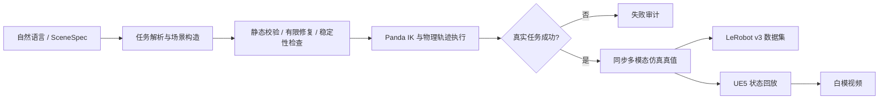

# 自然语言机器人数据管线

用户输入自然语言，系统解析任务、构造场景、执行机械臂轨迹，输出 **LeRobot v3 仿真真值数据集** 和 **UE5 白模视频**。

当前主链路面向 **Franka Panda 桌面抓取放置、堆叠、推动**。物理执行和成功判定来自 ManiSkill3 / SAPIEN；UE5 负责白模可视化。项目是受约束任务管线，尚不支持任意语言任务或任意机械臂。



## 能力与边界

| 模块 | 当前能力 | 使用边界 |
| --- | --- | --- |
| 自然语言解析 | OpenAI 兼容服务输出结构化 JSON；无 key 时显式本地解析回退 | 不是任意任务生成器 |
| 场景构造 | SceneSpec、几何物体、Panda、相机、任务与成功判据 | 内置几何资产与桌面模板 |
| 场景验证 | 结构、碰撞、支撑、工作空间、有限位置修复、短时物理检查 | 静态通过不代表完整任务可完成 |
| 轨迹生成 | 数值 IK、路点插值、真实控制器执行与末尾成功保持 | Panda 的 pick/place、stack、push；不等于通用无碰撞规划 |
| 真值与数据集 | RGB、深度、法线、分割、状态、动作、相机矩阵、时间戳 → LeRobot v3 | 仿真真值；密集数值列可能较大 |
| UE 白模视频 | 按同一物理轨迹回放、输出 MP4 与回放报告 | 支持隐藏编辑器后台逐观测渲染；相机与 SAPIEN 真值相机不同 |
| 既有数据导入 | `data_engine/` 提供独立的导入和转换工作台 | 不属于自然语言主链路；外部验证样本不随仓库发布 |
| UE-only / PORTAL | 保留现有实验代码与注册任务预览接口 | UE-only 有占位深度/法线/矩阵和颜色分割；PORTAL 未接通成功轨迹导出 |

**完整交付要同时检查数据与视频：** `status=complete` 表示数据 episode 成功；UE 渲染失败时仍保留有效数据，通过 `ue_render_error` 报错。验收两种产物时，应检查视频路径存在且渲染错误为空。

## 快速开始

环境与 UE 资产准备见 [安装与运行](docs/SETUP.md)。以下在仓库根目录执行：

```powershell
# Python 3.11：网页 / 场景 / 仿真
python -m venv .venv-sim
.venv-sim\Scripts\python.exe -m pip install -r requirements-dev.txt
.venv-sim\Scripts\python.exe -m pip install -r EnvDreamer/ManiSkillGen/requirements-maniskill.txt

# 独立 Python 3.12：LeRobot 转换
py -3.12 -m venv lerobot_conversion/.venv
lerobot_conversion\.venv\Scripts\python.exe -m pip install -r lerobot_conversion/requirements.txt

# 启动网页，打开 http://127.0.0.1:8765/
Set-Location EnvDreamer
..\.venv-sim\Scripts\python.exe -m ManiSkillGen --port 8765
```

输入示例：`Panda 把红色方块放到蓝色目标区域`。网页生成数据时默认请求 UE 视频，需要先启动 UE 项目。仅生成物理数据可运行：

```powershell
# 在 EnvDreamer 目录
..\.venv-sim\Scripts\python.exe -m ManiSkillGen.pipeline --spec ManiSkillGen/examples/pipeline_pick_place.json --episodes 1 --seed 11
# 增加 --render-ue 同时请求白模视频
```

## 仓库布局

```text
EnvDreamer/
  ManiSkillGen/       # 自然语言、SceneSpec、仿真、轨迹、真值、网页和测试
  EnvGen/
    Scripts/         # UE Remote Control、白模回放、LeRobot 桥接
    Source/          # UE C++ 场景与机器人 Actor
    Config/          # UE 项目和桌面配置
    Content/Robots/FrankaPanda/  # Panda 资产与来源许可
lerobot_conversion/  # embodied_gt_v1 → LeRobot v3、验证器、源真值读取
data_engine/         # 补充的轨迹导入与转换工作台
scripts/             # 环境诊断与固定版本 UE 基础资产恢复
docs/                # 架构、安装、数据语义、验收记录
```

输出位于 `EnvDreamer/ManiSkillGen/outputs/datasets/<run_id>/episode_NNN/`：`lerobot_v3/`、`lerobot_v3.zip`、`episode.json`、可选 `ue_white.mp4` 与内部 `trajectory.h5`。`extras/source_episode.h5` 是数据集内的无损源归档。生成数据、环境、缓存和本地凭据不纳入 Git。

## 文档与验证

- [五条自然语言全流程验收](docs/FIVE_CASE_ACCEPTANCE_2026-11-01.md)
- [Web 问题修复与回归结果](docs/WEBAPP_FIXES_2026-11-01.md)
- [架构与工作范围](docs/ARCHITECTURE.md)
- [安装、启动、接口与 UE 配置](docs/SETUP.md)
- [数据契约与时间对齐](docs/DATA_CONTRACT.md)
- [2026-11-01 本次整理与验证记录](docs/VALIDATION.md)
- [第三方来源与许可说明](THIRD_PARTY_NOTICES.md)

```powershell
# 仓库根目录：常规测试，不启动 UE
python -m pytest -q
# 真实仿真与 LeRobot 导出（需要两个运行时）
$env:MANISKILL_INTEGRATION='1'
python -m pytest -q
```

GitHub Actions 运行 CPU 单元/API 测试和语法编译；GPU 仿真、LeRobot 实际转换与 UE 渲染属于本地验收，详见验证记录。
